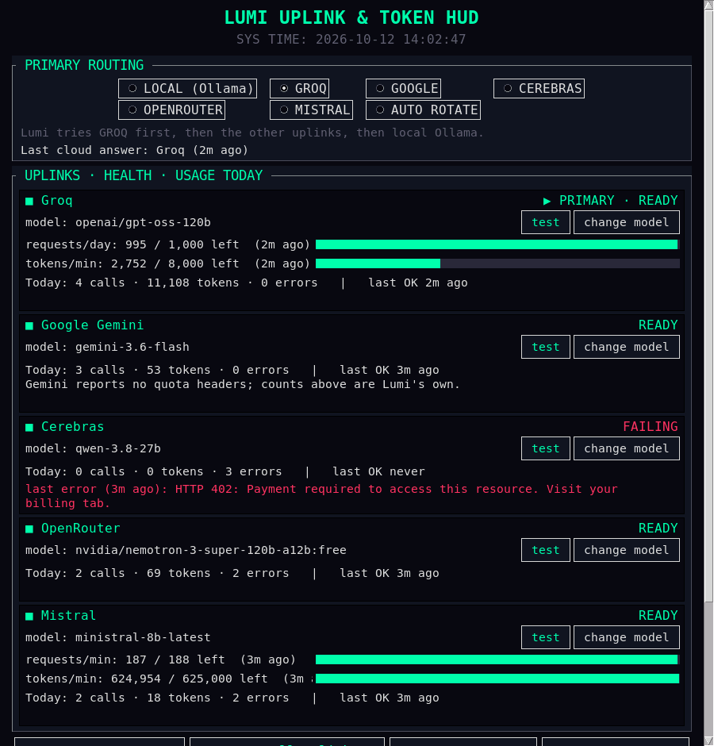

**LLM Token Vault & Routing HUD**

An encrypted, lightweight API key manager and multi-provider routing dashboard designed for edge computing, cyberdecks, and local AI projects.

Created by 4rch0n-c0c0nu7.

**The Problem**

Most open-source AI projects tell you to paste your highly sensitive API keys into a plaintext .env file. If you are building on portable hardware (like a Raspberry Pi cyberdeck) and your device is lost or stolen, your API keys are compromised instantly. Furthermore, enterprise-grade LLM routers usually require heavy Docker containers, PostgreSQL databases, and Redis caches—which is massive overkill for a local maker project.

**The Solution**

This project provides a scalpel instead of a sledgehammer. It features a pure-Python, lightweight Tkinter HUD that routes your prompts across multiple providers (Groq, Gemini, Cerebras, OpenRouter, Mistral) while keeping your API keys locked inside a hardware-tied AES-256 encrypted vault.

**Key Features**

* **Hardware-Locked Encryption:** Uses cryptography.fernet and PBKDF2HMAC to encrypt your keys. The decryption key is derived from a salt and your system's hardware ID (/etc/machine-id on Linux, falling back to UUID on Mac/Windows). If the keys file is stolen and moved to another computer, it cannot be decrypted.
* **Real Health Checks:** TEST sends a tiny real chat request to the exact model you've configured. A key that's valid but pointed at a retired model, out of credits, or rate-limited shows up as FAILING with the provider's own error message, not a false "SUCCESS".
* **Real Usage Telemetry:** Calls, tokens and errors per provider for today (from your assistant's actual calls, via a shared usage ledger), plus the provider's own rate-limit meters when it sends them (Groq, Cerebras, Mistral). No placeholder numbers.
* **Model Picker:** Each card can list the provider's live model catalog and switch models with one click (then auto-tests it).
* **Live Routing:** Pick a primary provider, LOCAL (Ollama), or AUTO ROTATE. The assistant picks up the change on its next message, no restart.
* **Move to a New Machine:** Because the vault is hardware-locked, use **Export Keys…** (passphrase-encrypted file) on the old machine and **Import Keys…** on the new one.
* **Lightweight:** No heavy server stacks required. Perfect for Raspberry Pi 5.

**Files**

* `token_dashboard.py` — the Tkinter HUD.
* `lumi_vault.py` — hardware-locked encrypted key vault (`~/lumi_keys.json`).
* `lumi_uplinks.py` — shared provider table, routing, usage ledger, health checks, key export/import. Import it from your assistant so the dashboard and assistant never drift apart.

**Hooking up your assistant**

```python
import lumi_uplinks as up
for prov in up.ordered_providers():          # honors the dashboard's routing choice
    ...                                      # call prov["base_url"] with prov["model"]
    up.record(prov["id"], True, response.usage, raw_headers, model=prov["model"])  # or record(..., False, error=e)
    up.set_last_active(prov["name"])
```

Config files: `~/lumi_routing.json` (routing), `~/lumi_providers.json` (model overrides), `~/.lumi_usage.json` (usage ledger).

**Installation & Setup**

1. Clone the repository:
   `git clone https://github.com/4rch0n-c0c0nu7/LLM-Token-Vault.git && cd LLM-Token-Vault`
2. Install the dependency: `pip install cryptography` (Tkinter ships with most Python installs; on Debian/Raspberry Pi OS: `sudo apt install python3-tk`).
3. Run: `python3 token_dashboard.py`, then **Manage API Keys** and **⚡ Test All Uplinks**.
